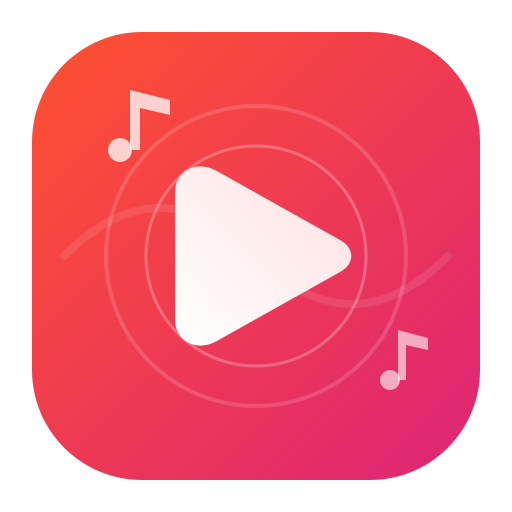
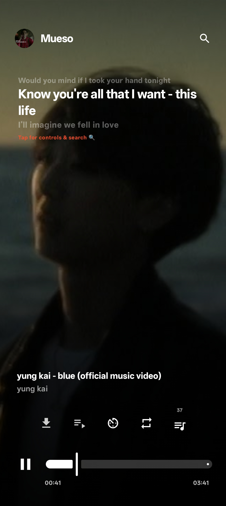
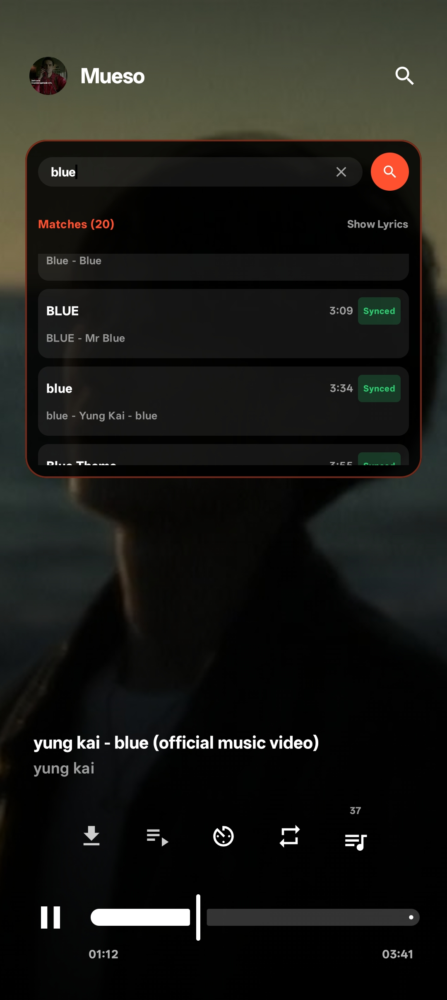
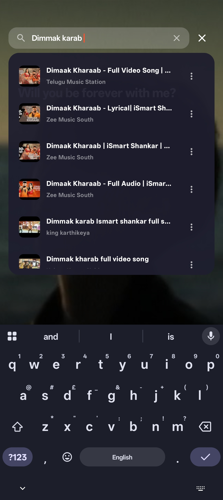
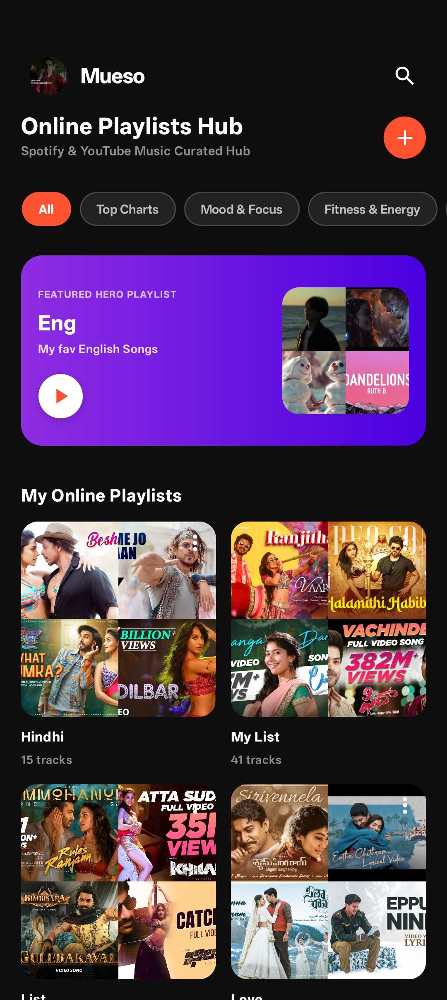
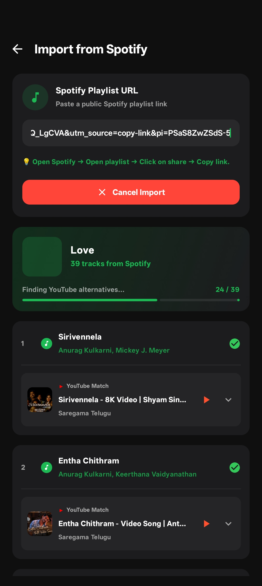
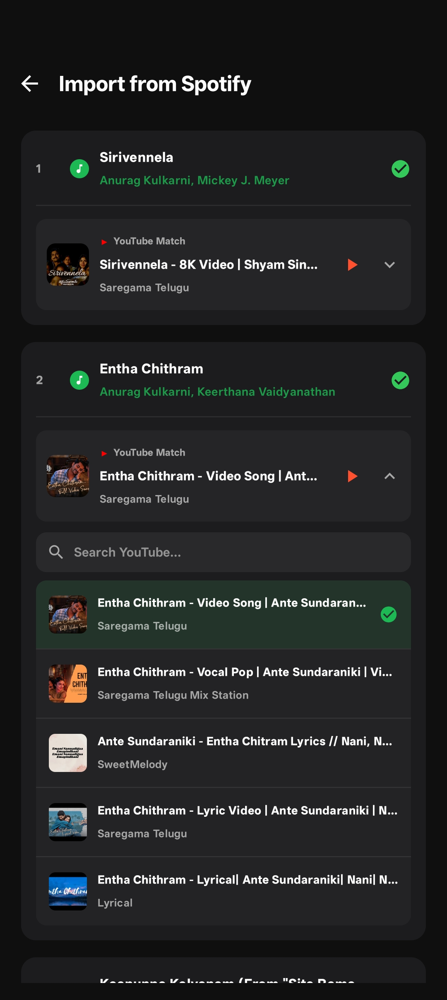
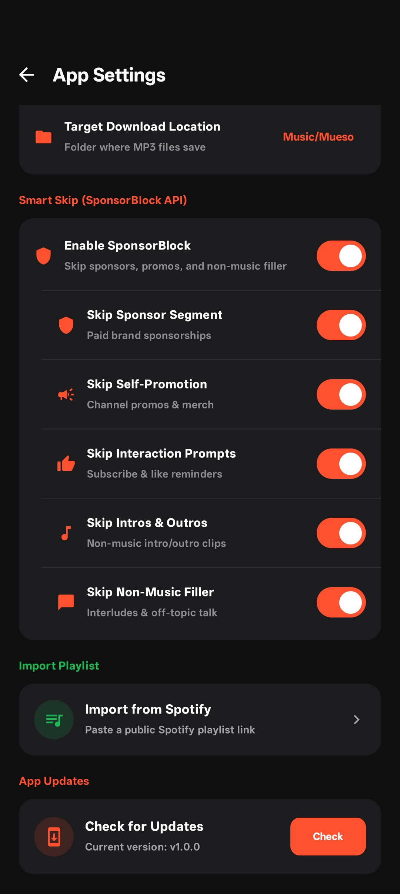
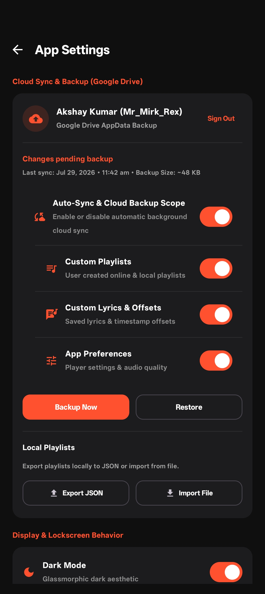

<div align="center">
  
  <h1>Mueso</h1>
  <p><strong>A Modern, Open-Source Android Music Player</strong></p>

  <p>
    
    
    
  </p>
  <p>
    
    
    
    
  </p>
</div>

<br />

**Mueso** is a next-generation, high-performance, 100% native Android music player built with **Kotlin**, **Jetpack Compose**, **Material 3**, and **AndroidX Media3 ExoPlayer**. It requires **zero external backend servers or Python microservices**—running entirely client-side on-device. It seamlessly bridges local offline audio libraries with online streaming, native YouTube Music personalization, rich artist pages, mood & genre exploration, real-time LRCLIB synced lyrics, smart SponsorBlock segment filtering, native ID3/MP4 metadata tagging, offline downloads, and network-loss auto-resumption.

> [!WARNING]
> **DO NOT USE THIS PLAYER AS YOUR DAILY DRIVER!**
> Honestly, I don't know much - this entire app is basically **AI slop**. Even if someone submits a contribution or PR, I may not review it correctly. I am also not very active and probably won't respond to issues frequently.
> 
> What you *can* do is open issues to point out my mistakes, bugs, or suggestions for improvement, but please don't expect them to be fixed or updated promptly.
>
> And yes, This is my primary Music player 😅.

> [!TIP]
> **Creating or importing a playlist is recommended for the best experience!** Import your favorite Spotify playlists or sync your YouTube Music account to enjoy seamless queue management and reels-style vertical playback.

---

## 📱 Screenshots & Previews

<div align="center">
  <table>
    <tr valign="top">
      <td align="center" valign="top" width="25%">
        <br />
        <sub><b>Reels-Style Player</b></sub>
      </td>
      <td align="center" valign="top" width="25%">
        <br />
        <sub><b>Search & Pick Lyrics</b></sub>
      </td>
      <td align="center" valign="top" width="25%">
        <br />
        <sub><b>Online Multi-Category Search</b></sub>
      </td>
      <td align="center" valign="top" width="25%">
        <br />
        <sub><b>Curated Playlists & Moods</b></sub>
      </td>
    </tr>
    <tr valign="top">
      <td align="center" valign="top" width="25%">
        <br />
        <sub><b>Spotify Playlist Import</b></sub>
      </td>
      <td align="center" valign="top" width="25%">
        <br />
        <sub><b>Stream Matching Review</b></sub>
      </td>
      <td align="center" valign="top" width="25%">
        <br />
        <sub><b>SponsorBlock Settings</b></sub>
      </td>
      <td align="center" valign="top" width="25%">
        <br />
        <sub><b>App Settings & Account Sync</b></sub>
      </td>
    </tr>
  </table>
</div>

---

## ✨ Features

- **📱 Reels-Style Vertical Swipe Player**: Modern fullscreen Vertical Pager layout for smooth swipe-up/down gestures to transition between tracks like reels, complete with dynamic background artwork blur, animated playback controls, and quick lyrics view (101% inspired by the legendary Resso app).
- **📻 Classic Player & Floating Mini Player**: Switch anytime between the immersive reels player and a classic player layout featuring an animated floating mini-player capsule with gesture controls.
- **🖼️ Interactive Player Background Framing**: Long-press and drag sideways on the fullscreen player background to custom-frame and position album art. Customized positions are persisted and synced per playlist track.
- **🎨 Dynamic Theming & Pure Black AMOLED**: Pitch-black pure AMOLED dark mode for OLED battery savings, light mode, vibrant multi-shade accent color palettes, dynamic font scaling, and adjustable card corner radius.
- **⚡ Pure Dynamic YouTube Music Hub**: 100% data-driven shelves parsed verbatim from YouTube's InnerTube backend (*India's biggest hits*, *Trending community playlists*, *Today's Global Hits*, *Romance Right Now*, *Dancing on your own*, *New releases*, etc.) with multi-batch continuation auto-hydration for rich, deep scrolling.
- **🌐 Auto Language Mode (Default)**: Intelligent default mode that lets YouTube's recommendation engine deliver localized regional and time-of-day shelves dynamically without hardcoded section rules or artificial content blending.
- **🛡️ Anonymous Guest Personalization & Privacy Architecture**:
  - **Default: OFF (100% Private)**: Operates with strict privacy out of the box. Server-issued anonymous guest session tokens (`visitorData`) are used solely for multi-batch shelf continuation and pagination. Zero listening history, zero telemetry, and zero playback statistics are ever transmitted to YouTube.
  - **Opt-In Taste Adaptation**: When enabled during Onboarding or in Settings, anonymous guest playback pings allow YouTube's algorithm to gradually adapt and personalize recommendations ("Quick picks", tailored mixes) without requiring a Google account or login.
  - **1-Tap Session Reset**: One-tap "Reset Guest Session" in Settings instantly wipes the guest token and purges recommendation history, resetting recommendations back to clean regional charts immediately.
- **🔐 Optional YouTube Music Account Sync**: Connect your Google account anytime to stream your personal library, private playlists, and cloud favorites without third-party servers.
- **🎤 Dedicated Artist Detail Pages**: Full-featured artist exploration screen featuring artist banner, subscriber count, bio, and organized sections for **Top Songs**, **Albums**, **Singles & EPs**, **Music Videos**, **Live Performances**, **Featured On**, and **Similar Artists**, plus instant **Radio** and **Shuffle** launch buttons.
- **🔍 Multi-Category Search & LRU Caching**: Fast search across **All**, **Songs**, **Videos**, **Albums**, **Playlists**, and **Artists** with in-memory caching for instant tab switches without redundant network calls.
- **🎭 Moods, Genres & Curated Shelves**: Explore dynamic categories (Chill, Focus, Workout, Party, Romance, Charts, and more) with customized row shelves and direct playlist playback.
- **🚀 Pure Native Audio Streaming & Continuous Background Playback**: High-performance streaming with multi-strategy InnerTube extraction, proactive next-track prefetching, partial WakeLock, and battery-optimization guard for uninterrupted listening when the screen is off or in the background.
- **🎵 Synced Lyrics & Interactive Candidate Picker**: Automatic real-time synced lyrics via LRCLIB with line-by-line karaoke highlights, manual timing offset adjusters (+/- 500ms), and an interactive search dialog to match alternate lyrics.
- **🟢 Smart Spotify Import & Delta Sync**:
  - Paste any public Spotify playlist URL to instantly fetch track listings and match them against high-quality online audio streams.
  - **Permanent Link Storage & 1-Tap Delta Sync**: Stored Spotify links allow one-tap syncing that automatically deduplicates existing tracks and matches *only newly added songs*.
  - **Batch Checkbox Selection**: Select, deselect, or search-match unmatched tracks before creating or syncing playlists.
- **📋 Smart Queue Management**: Up Next queue bottom sheet with drag-and-drop reordering, smooth animated track removal (`✕`), and clear queue controls.
- **🛡️ Smart SponsorBlock Audio Filtering**: Master toggle with customizable sub-settings to automatically skip non-music segments, sponsor messages, self-promotions, intros/outros, and filler in real-time during online streaming.
- **📥 Offline Library & Quality-Aware Downloads**: Download audio tracks directly in High / Medium / Low quality with natively embedded ID3v2.3 (MP3) and MP4 Box (M4A) metadata tags, high-res cover art, and companion `.lrc` lyrics files.
- **🔄 In-App Updates & Self-Installer**: Automatically check GitHub Releases for app updates, view changelogs, track download progress, and install new APKs directly within the app.
- **🔒 Lockscreen Controls & Sleep Timer**: Full playback controls on Android lockscreen and status bar media notification with configurable sleep timers (timer duration, after song, or end of playlist).
- **📶 Network Drop Resilience & Auto-Resumption**: Dedicated lifecycle network monitor (`NetworkMonitor`) that prevents queue skipping during cellular dips or dead zones (e.g., traveling between cell towers), automatically retrying and resuming playback seamlessly as soon as internet connectivity returns.
- **☁️ Automated Google Drive Backup**: Backup and restore your custom playlists, track background adjustments, hero banners, and app preferences securely to Google Drive AppData.

---

## 🔒 Privacy & Anonymous Guest Architecture

Mueso is built from the ground up to respect user privacy. Unlike conventional music streaming clients that require mandatory Google account logins and aggressively log user activity, Mueso decouples media consumption from personal identity:

| Dimension | Default Mode (Strict Privacy) | Guest Personalization (Opt-In) | Google Account Sync (Optional) |
| :--- | :--- | :--- | :--- |
| **Privacy Level** | **100% Private (Zero Tracking)** | **Pseudonymous / Ephemeral** | Standard Authenticated |
| **Account Required** | None | None | Optional Google Account |
| **Listening Telemetry** | **Zero stats or history sent** | Anonymous playback pings only | Linked to user's YouTube Music profile |
| **Visitor Token Usage** | Multi-batch continuation & pagination | Multi-batch pagination + taste modeling | Account profile & personal mixes |
| **Personalization Type** | Pure regional & time-of-day charts | Dynamic "Quick picks" & tailored mixes | Saved playlists, liked music, subscribed artists |
| **Reset / Purge** | N/A (Nothing recorded) | **1-Tap "Reset Guest Session"** | Disconnect / sign out |

### Key Privacy Pillars
1. **Verbatim Dynamic Feeds**: The home hub displays 100% data-driven shelves directly from YouTube's InnerTube backend (*India's biggest hits*, *Trending community playlists*, *Today's Global Hits*, *Romance Right Now*, *Dancing on your own*, *New releases*, etc.). In **Auto Language** mode, YouTube's engine serves authentic localized content and time-of-day shelves naturally without artificial section blending.
2. **Stateless Pagination by Default**: Server-issued visitor session tokens (`visitorData`) are strictly employed as continuation cursors to hydrate multi-batch feeds. Zero listening telemetry or tracking beacons are dispatched.
3. **Opt-In Recommendation Training**: If you prefer personalized music recommendations without linking a personal Google identity, enable **Guest Personalization** in Onboarding or Settings. Mueso sends anonymous playback pings that gradually train YouTube's recommendation engine for that isolated guest session.
4. **Instant One-Tap Wipe**: Tap **Reset Guest Session** (or **Reset Guest Taste Profile**) in Settings at any time to instantly flush the guest token from local storage. Your recommendation profile is wiped immediately, reverting the hub back to clean regional charts.

---

## 📦 Download & Release Builds

We publish automated signed builds via GitHub Actions with architecture-specific APK splits for optimal download sizes:

| Package | Target Architecture | Recommended For | Approximate Size |
| :--- | :--- | :--- | :--- |
| **`app-arm64-v8a-release.apk`** | 64-bit ARM | **Recommended for 95%+ of modern Android phones** | **~6.0 MB** |
| **`app-armeabi-v7a-release.apk`** | 32-bit ARM | Older 32-bit Android phones | **~6.0 MB** |
| **`app-x86_64-release.apk`** | 64-bit x86 | Android Emulators, ChromeOS, PC | **~6.0 MB** |
| **`app-universal-release.apk`** | All ABIs | Universal fallback (contains all architectures) | **~6.1 MB** |

---

## 🛠️ Architecture & Tech Stack

Mueso is built as a **100% Native Kotlin** Android application adhering strictly to **MVVM Clean Architecture** principles:

| Component | Technology |
| :--- | :--- |
| **UI Framework** | Jetpack Compose (1.6+), Material 3 Design System |
| **Audio Engine** | AndroidX Media3 ExoPlayer |
| **Headless Audio Engine** | android-youtube-player (Official IFrame wrapper for fallback audio streams) |
| **Media Service** | AndroidX MediaSessionService & MediaController IPC |
| **Online Client & Stream Resolver** | Native Kotlin InnerTube Client & Multi-Client Extraction Strategies (reference from Zuno) with Dynamic Shelf Auto-Hydration & Anonymous Guest Session Architecture |
| **Network Resilience** | Real-time ConnectivityManager Callback & StateFlow Auto-Recovery |
| **State Management** | Kotlin Coroutines, StateFlow, SharedFlow, ViewModel |
| **Database** | Room Persistence Library |
| **Networking & HTTP** | OkHttp 3, Moshi JSON |
| **Metadata Tagging** | JAudioTagger (Native Kotlin ID3v2.3 & MP4 Box Audio Tagger) |
| **Lyrics API** | LRCLIB Synced Lyrics API |
| **Cloud Backup** | Google Drive REST API & WorkManager Auto-Sync |
| **Sponsor Filtering** | SponsorBlock Community API |
| **App Updates** | GitHub Releases API & Android FileProvider Installer |
| **Image Loading** | Coil Compose |

---

## 🚀 Building & Setup

### Prerequisites
- **Android Studio**: Ladybug / Koala / Jellyfish (2024.1+)
- **JDK**: Version 17+
- **Min SDK**: 24 (Android 7.0)
- **Target SDK**: 36 (Android 15)

### Clone & Compile

```bash
# Clone the repository
git clone https://github.com/Akshay-86/Mueso.git
cd Mueso

# Build Debug APK
./gradlew assembleDebug
```

---

## 🙏 Credits & Inspirations

Mueso is built on top of amazing open-source technologies, community APIs, and great product inspirations:

- **[Resso](https://en.wikipedia.org/wiki/Resso) (by ByteDance)** - The core UI & UX inspiration for Mueso's reels-style vertical music player. A phenomenal, ahead-of-its-time music experience (now discontinued) that 101% inspired Mueso's entire fullscreen swipe-up listening flow.
- **[Zuno](https://github.com/noFAYZ/zuno)** - Open-source desktop YouTube Music client by [@noFAYZ](https://github.com/noFAYZ); foundational inspiration and reference for multi-client stream resolving strategies (iOS, Android, TV, Web Remix) and player options.
- **[SponsorBlock API](https://sponsor.ajay.app/)** - Crowd-sourced database for skipping non-music segments and sponsorships.
- **[android-youtube-player](https://github.com/PierfrancescoSoffritti/android-youtube-player)** - YouTube IFrame player wrapper by Pierfrancesco Soffritti.
- **[LRCLIB](https://lrclib.net/)** - Free and open community-driven synchronized lyrics provider.
- **[jaudiotagger](https://github.com/AdrienPoupa/jaudiotagger)** - Pure Java audio metadata tagging library by Adrien Poupa for ID3 & MP4 metadata.
- **[Coil](https://coil-kt.github.io/coil/)** - Fast, lightweight image loading library for Android and Jetpack Compose.

---

## 🤝 Contributing, Issues & Feedback

Contributors are very welcome! Feel free to **fork** this repository, make changes, and submit a **Pull Request**.

If any credits were missed, or if you have any issues, complaints, or feedback, feel free to:
- Open a GitHub [Issue](https://github.com/Akshay-86/Mueso/issues) or submit a [Pull Request](https://github.com/Akshay-86/Mueso/pulls).
- Or email directly at **[nalliakshaykumar@gmail.com](mailto:nalliakshaykumar@gmail.com)**.

---

## 📄 License

Distributed under the **MIT License**. See [`LICENSE`](LICENSE) for more information.
